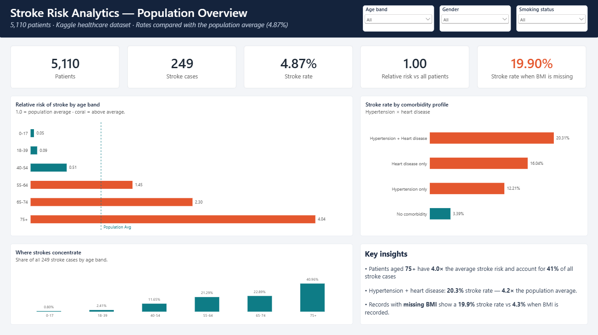
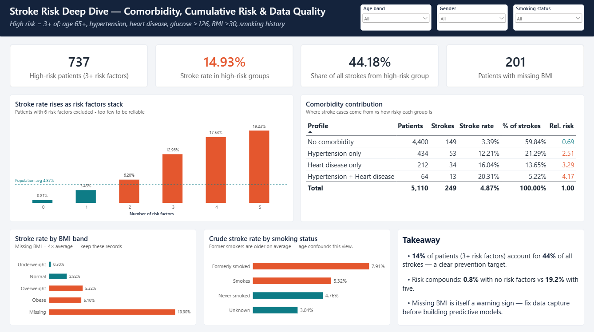

# Stroke Risk Analytics — Power BI Portfolio Project

End-to-end healthcare analytics project: **data quality → Power Query → star schema → DAX → interactive dashboard**.


---

## Business question

Which patient segments carry the highest **stroke incidence**, how do **clinical risk factors compound**, and where should a prevention program focus first?

---

## Dashboard

### Overview — risk landscape



### Deep Dive — compounding risk & concentration



Interactive report: [`model/Stroke_Risk_Analytics.pbix`](model/Stroke_Risk_Analytics.pbix)

---

## Key insights

1. **Age dominates.** Patients aged **75+** show roughly **4×** the baseline stroke rate (~4.9%). Age is the strongest single driver in this dataset.
2. **Risk compounds.** Stroke rate rises as clinical factors stack (hypertension, heart disease, high glucose, obesity, smoking history). Patients with **3+** factors are a small share of the population but a large share of strokes.
3. **Concentration.** About **14%** of patients (3+ risk factors) account for roughly **44%** of stroke cases — a clear prevention focus cohort.
4. **Missing BMI is a signal.** ~**19.9%** stroke rate when BMI is missing vs ~**4.3%** when present. Rows were **not dropped**; missingness was flagged and median-imputed by age band × gender.
5. **Smoking needs age context.** Crude rates can rank *Formerly smoked* above *Smokes* because former smokers are older on average — a classic confounding pattern.

---

## Skills demonstrated

| Area | What is in this repo |
|------|----------------------|
| Data quality | Missing BMI treatment, smoking Unknown retained, encoding cleanup |
| Power Query (M) | Cleaning script + star-schema dimension/fact queries |
| Data modeling | Fact `FactStrokeAssessment` + 9 dimensions |
| DAX | Stroke rate, relative risk vs baseline, contribution %, high-risk flags |
| Visualization | Full HD report, synced slicers, conditional formatting, analytics lines |
| Documentation | Data quality write-up, data dictionary, model notes |

---

## Dataset

| Item | Detail |
|------|--------|
| Source | [Kaggle — Stroke Prediction Dataset](https://www.kaggle.com/datasets/fedesoriano/stroke-prediction-dataset) |
| Size | 5,110 patients × 12 attributes |
| Target | `stroke` (249 positives, **4.87%** — highly imbalanced) |
| Raw file | `data/raw/healthcare-dataset-stroke-data.csv` |

---

## Model overview

```
FactStrokeAssessment  (grain: one patient assessment)
   ├── DimAgeBand
   ├── DimGender
   ├── DimMaritalStatus
   ├── DimWorkType
   ├── DimResidence
   ├── DimSmokingStatus
   ├── DimClinicalProfile
   ├── DimGlucoseBand
   └── DimBMIBand
```

| Artifact | Path |
|----------|------|
| Star schema diagram | [`assets/screenshots/03_star_schema_model.png`](assets/screenshots/03_star_schema_model.png) |
| Measure list | [`assets/screenshots/06_measures_list.png`](assets/screenshots/06_measures_list.png) |
| DAX library | [`dax/`](dax/) |
| Power Query scripts | [`powerquery/`](powerquery/) |
| Data quality notes | [`docs/01_data_quality_assessment.md`](docs/01_data_quality_assessment.md) |
| Data dictionary | [`docs/02_data_dictionary.md`](docs/02_data_dictionary.md) |
| Model notes | [`docs/03_data_model.md`](docs/03_data_model.md) |

---

## Repo structure

```
stroke_prediction/
├── README.md
├── data/raw/ · data/processed/
├── powerquery/              # Cleaning + star schema M
├── dax/                     # Core + formatting measures
├── model/Stroke_Risk_Analytics.pbix
├── docs/                    # DQ, dictionary, model notes
└── assets/screenshots/      # Portfolio images
```

---

## How to open the report

1. Install [Power BI Desktop](https://powerbi.microsoft.com/desktop/).  
2. Open `model/Stroke_Risk_Analytics.pbix`.  
3. If the CSV path needs updating: **Transform data** → edit the source path in `StrokeRawCleaned`, or reload using the scripts in `powerquery/`.

---

## Disclaimer

Portfolio / educational use only. Glucose and BMI bands are **analytical groupings**, not clinical diagnoses or treatment guidance. See also [`docs/DISCLAIMER.md`](docs/DISCLAIMER.md).

---

## Author

**Hristo Dimitrov** · [LinkedIn](https://www.linkedin.com/in/hristo-dimitrov-0681a8246) · [GitHub](https://github.com/HristoDimitrov03)
